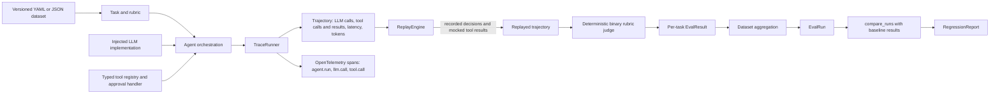

# Agent Evaluation & Observability Harness

A small, provider-independent Python harness for exercising tool-using agents against versioned tasks. It captures each execution as a trajectory and OpenTelemetry spans, replays the recorded model decisions and tool results without repeating the original tool effects, grades the replay with deterministic rubric checks, and aggregates task results into comparable evaluation runs.

The repository contains a working vertical slice from task definition through dataset-level regression reporting. It currently uses a deterministic `FakeLLM` for its examples; a production LLM adapter, persistent run store, and CI gate are not implemented yet.

## What the Project Does

For one task, `EvaluationPipeline` performs these steps:

1. Runs the agent with the task prompt, injected LLM implementation, and typed tools.
2. Wraps LLM and tool boundaries to capture a `Trajectory` and nested OpenTelemetry spans.
3. Replays the recorded LLM decisions and tool outputs, checking that the same calls and inputs are made without invoking the original tool functions again.
4. Evaluates the replayed trajectory against the task's binary rubric.
5. Returns the execution artifacts and an `EvalResult`.

For a dataset, `evaluate_dataset()` repeats that workflow for each task, retains task-level errors as failed results, and computes an `EvalRun`. `compare_runs()` compares two complete runs over the same dataset version and task IDs, returning a `RegressionReport`.

## Architecture



### Main components

| Package | Responsibility |
| --- | --- |
| `agent_eval.schema` | Pydantic task, rubric, and versioned dataset contracts; YAML and JSON loading. |
| `agent_eval.agent` | Provider-neutral LLM interface, structured decisions, tool registry, typed input/output validation, approval checks, and orchestration loop. |
| `agent_eval.tracing` and `agent_eval.telemetry` | Capture trajectories and emit OpenTelemetry spans around agent runs, LLM calls, and tool calls. |
| `agent_eval.replay` | Re-run recorded LLM decisions and serve recorded tool results, validating tool order and inputs without re-executing original tool functions. |
| `agent_eval.judge` | Deterministic binary checks for tool sequence, tool result fields, and final-response text. |
| `agent_eval.evaluation` | Single-task and dataset-level pipelines, metric aggregation, and baseline/candidate regression comparison. |
| `agent_eval.models` | Shared schemas for trajectories, replay sessions, rubric judgments, task results, runs, and regression reports. |

## Metrics and Regression

Each `EvalResult` represents one task and includes its rubric score and pass/fail status, measured execution latency, token total, resolution status, tool-call count, LLM-turn count, timestamp, and an optional error. Safety, policy, and side-effect fields exist in the result model, but the current evaluator does not populate them.

Each `EvalRun` aggregates the task results:

| Metric | Meaning |
| --- | --- |
| Mean score | Arithmetic mean of task rubric scores, from 0 to 1. |
| Pass rate | Fraction of tasks passing every rubric check. |
| Passed / failed / total tasks | Task counts for the run; an execution or grading error counts as failed with score 0. |
| Resolved tasks | Count of results with a non-empty final response. |
| Total tokens and tokens per task | Sum and average of trajectory token totals. Provider adapters must supply token counts; the demo fake returns none. |
| Tool calls and agent turns per task | Average number of recorded tool calls and LLM calls. |
| p50 / p95 latency | Nearest-rank percentiles across task execution latency in milliseconds. |

`compare_runs(baseline.run, candidate.run, baseline.results, candidate.results)` reports mean-score and pass-rate differences, task IDs whose scores dropped, and the p95 latency difference. A quality regression is detected when the mean score or pass rate drops by its configured threshold, or any task drops by its task threshold. Each threshold defaults to `0.05`. Latency change is reported but does not currently trigger regression detection. Comparisons reject different dataset versions, mismatched task coverage, duplicate task results, or results associated with the wrong run.

The model includes optional token-cost fields, but the current aggregation does not estimate or populate monetary cost. Dataset aggregation is in-memory; there is no historical run database or automatic CI failure gate yet.

## Quickstart

Python 3.10 or later is required. Install the package and development dependencies:

```powershell
python -m pip install -e ".[dev]"
```

Run the provider-independent agent demonstration:

```powershell
python -m agent_eval.agent.demo
```

Run the end-to-end single-task trace, replay, and evaluation demonstration:

```powershell
python -m agent_eval.demo
```

Run the test suite:

```powershell
python -m pytest
```

## Evaluate and Compare a Dataset

```python
from agent_eval.agent import Agent, FakeLLM, create_default_tools
from agent_eval.evaluation import EvaluationPipeline, compare_runs
from agent_eval.schema.dataset import EvaluationDataset

# This FakeLLM is only a deterministic refund-demo simulator.
dataset = EvaluationDataset.load_from_yaml("datasets/refund.yaml")
agent = Agent(
    llm=FakeLLM(),
    tools=create_default_tools(),
    approval_handler=lambda _tool_name, _arguments: True,
)
pipeline = EvaluationPipeline(agent)

baseline = pipeline.evaluate_dataset(
    dataset, run_id="baseline", prompt_version="v1"
)
candidate = pipeline.evaluate_dataset(
    dataset, run_id="candidate", prompt_version="v2"
)
report = compare_runs(
    baseline.run,
    candidate.run,
    baseline.results,
    candidate.results,
)
print(report.summary)
```

For a real agent, implement the `LLM.generate(messages) -> LLMDecision` interface and inject it into `Agent`. Supply an approval handler for tools marked as requiring approval. The sample refund tools operate on in-memory demo data; approving them in this example is not a production authorization policy.

## Datasets

The repository includes YAML examples for refunds and order cancellation. A dataset has a version, name, optional description and metadata, and a list of tasks. Each task contains an ID, prompt, expected outcome/tools, metadata, and rubric checks. Supported rubric kinds are:

- `tool_sequence`: exact ordered list of tool names.
- `tool_result_contains`: expected fields within a successful tool output.
- `final_response_contains`: case-insensitive substring in the final response.

The dataset version is used to guard comparisons. Keep it stable for comparable evaluations and bump it when task or rubric changes would make historical scores incomparable.

## Current Implementation and Next Extensions

Implemented now: typed agent/tool orchestration, approval-gated tools, OpenTelemetry instrumentation, in-memory trajectory capture, deterministic replay, binary rubric judging, per-task evaluation, dataset aggregation, and threshold-based run comparison. Unit tests cover the core agent, schema, telemetry, replay, judge, metrics, and pipeline components.

Not implemented yet: SQLite/PostgreSQL persistence, a production LLM adapter, an LLM-based judge, CI regression gating, online evaluation, dashboards, and artifact storage/versioning. `agent_eval.storage` is currently a placeholder. Telemetry captures prompt, response, tool input, and tool output content when spans are recorded; add redaction or content-capture controls before using it with sensitive production data.
